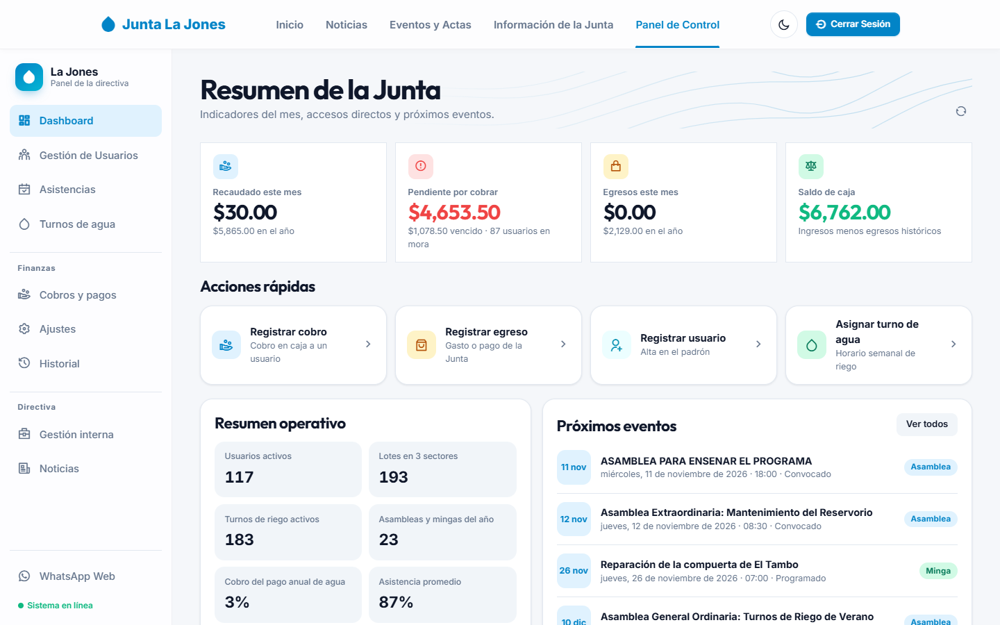
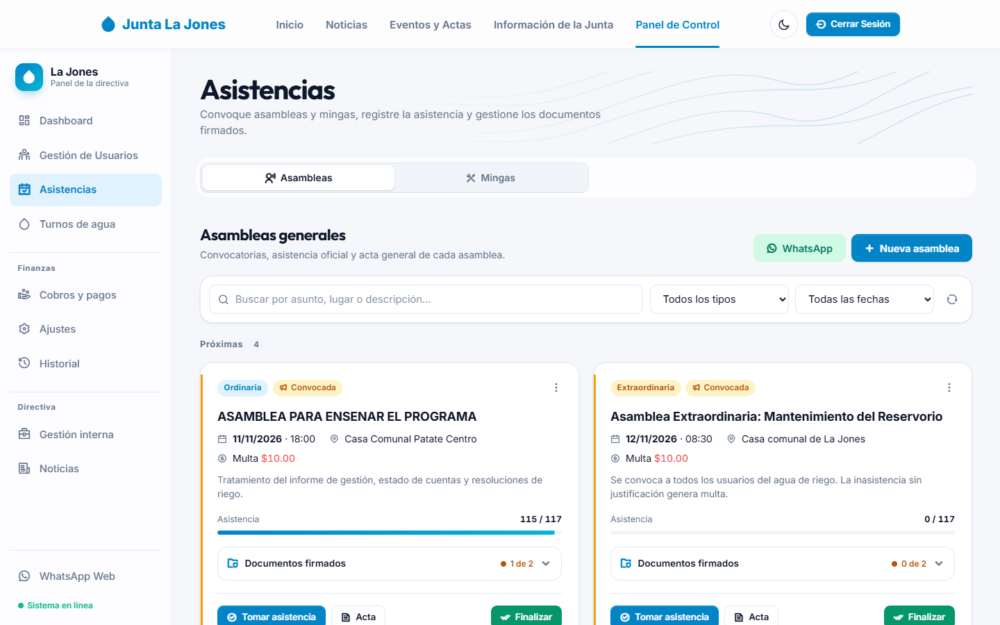
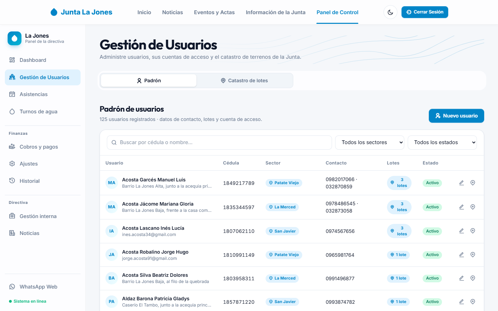
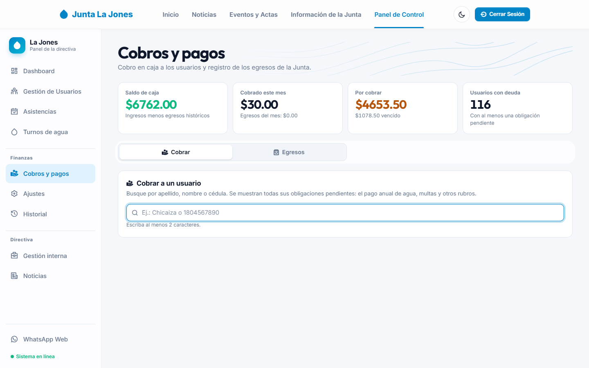
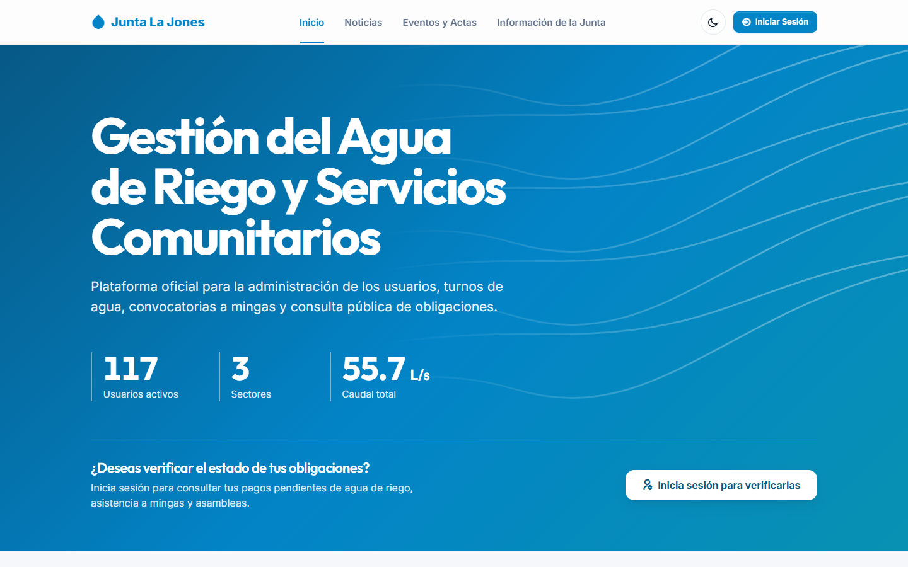
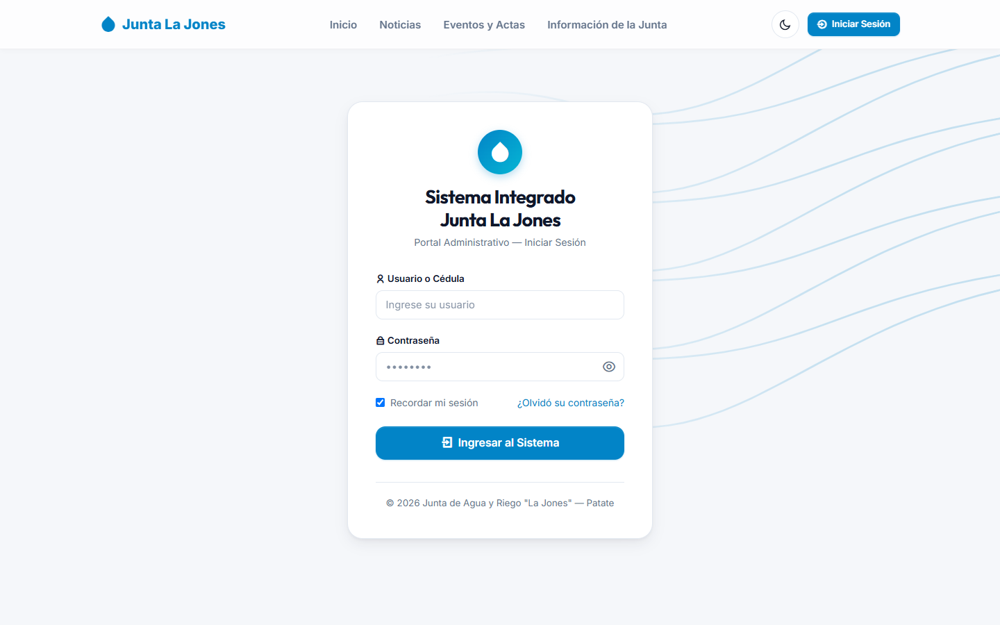
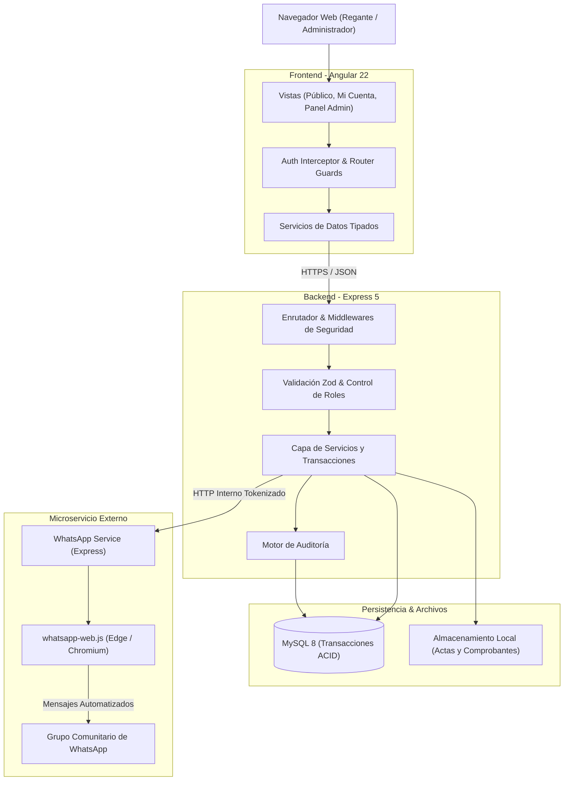

# 💧 Sistema de Gestión - Junta de Agua y Riego "La Jones"

[](https://angular.dev/)
[](https://nodejs.org/)
[](https://expressjs.com/)
[](https://www.mysql.com/)
[](https://www.typescriptlang.org/)
[](https://www.docker.com/)

**Sistema de Gestión - Junta de Agua y Riego "La Jones"** es una solución web integral diseñada para sistematizar y centralizar la administración comunitaria, financiera y técnica de la Junta de Agua y Riego "La Jones", ubicada en el cantón Patate, provincia de Tungurahua, Ecuador. Proporciona herramientas para el control del catastro de usuarios y lotes georreferenciados, programación de turnos de riego, registro de asistencia a asambleas y mingas con imposición automática de multas por inasistencia, recaudación en caja con emisión de comprobantes en PDF, emisión del pago anual del agua y un portal de autogestión para los regantes.

El proyecto fue desarrollado para resolver las dificultades históricas de gestión manual en territorio, erradicando pérdidas de registros en papel, cruces de horarios en el caudal de riego y falta de trazabilidad en las cuotas comunitarias, bajo un marco seguro de auditoría de base de datos y comunicación por mensajería instantánea.

> [!TIP]
> Para poner en marcha el proyecto rápidamente en modo desarrollo con base de datos y datos de demostración realistas, ejecute desde la raíz:
> ```bash
> npm run dev
> ```
> O en Windows haga doble clic en el archivo `presentar.bat`. El frontend se abrirá en `http://localhost:4200` y la API en `http://localhost:3000`.

---

## 📋 Descripción

### ¿Qué problema resuelve?
Las organizaciones comunitarias de riego suelen gestionar su padrón de socios, distribución de turnos de agua y cobros mediante cuadernos físicos y actas impresas. Esta dinámica genera conflictos frecuentes por solapamiento de horarios en acequias, opacidad en los cobros de multas por faltas a mingas y asambleas, extravío de comprobantes de pago y dificultades para cobrar la tarifa anual de mantenimiento. Este sistema digitaliza todo el ciclo operativo, garantizando transparencia, control territorial y orden administrativo.

### ¿Qué hace?
1. El administrador inicia sesión de manera segura con su cédula y credenciales protegidas con bloqueo ante intentos fallidos.
2. Registra y actualiza el padrón de socios con sus datos personales, cédula ecuatoriana validada y lotes georreferenciados en el mapa interactivo.
3. Planifica la distribución semanal de turnos de riego por sector, impidiendo automáticamente la asignación simultánea de dos usuarios al mismo tramo de caudal.
4. Convoca a asambleas y mingas, publicando los avisos formales en el grupo oficial de WhatsApp y generando la hoja de asistencia en PDF para firmas en territorio.
5. Toma la asistencia digital durante o después del evento; el sistema identifica a los inasistentes sin justificación y genera automáticamente las multas financieras correspondientes.
6. En ventanilla de caja, cobra cuotas de mantenimiento, multas y consumos pendientes, emitiendo comprobantes digitales en PDF y registrando el egreso de fondos de la Junta.
7. Al cierre de cada ciclo, emite masivamente las obligaciones de agua anual a los socios activos con lote asignado.
8. Cada socio accede a su portal privado para consultar sus deudas, revisar sus turnos de riego asignados y verificar el historial de sus aportes.

### ¿Para quién está pensado?
- **Directiva de la Junta de Agua y Riego:** Presidente, tesorero y recaudador, quienes administran el cobro en caja, la cobranza de multas, la tesorería y las convocatorias.
- **Socios y regantes comunitarios:** Agricultores y familias que necesitan consultar el estado de su cuenta, verificar sus turnos asignados de agua y enterarse de eventos comunitarios sin tener que acudir presencialmente a la sede.

---

## 📸 Capturas

| Captura | Vista |
|:---:|:---:|
| <br><sub>Dashboard principal con métricas financieras y operativas en tiempo real</sub> | <br><sub>Gestión de asambleas, mingas y toma de lista de socios</sub> |
| <br><sub>Padrón de regantes y georreferenciación territorial de predios</sub> | <br><sub>Módulo de cobro con desglose de obligaciones y emisión de comprobantes</sub> |
| <br><sub>Página de inicio y consulta comunitaria accesible a los socios</sub> | <br><sub>Acceso seguro con políticas de bloqueo y contraseñas temporales</sub> |

---

## ✨ Características

* **Gestión Catastral y Predial:** Registro integral de usuarios, asignación de lotes con coordenadas geográficas sobre Leaflet y transferencia documentada de titularidad con historial inmutable.
* **Control de Asistencia con Multas Automáticas:** Convocatoria de asambleas y mingas comunitarias, listados físicos y digitales con scroll fluido, carga de justificaciones médicas o laborales y generación automática de multas por inasistencia.
* **Turnos de Riego Libres de Conflicto:** Programación semanal por días y rangos horarios con validación algorítmica para evitar solapamientos dentro de cada sector.
* **Caja y Tesorería Completa:** Cobro unificado de cuotas, multas, emisión de recibos en formato PDF descargables e imprimibles, anulación justificada de pagos y registro de egresos por compras comunitarias.
* **Facturación Anual del Servicio de Agua:** Generación masiva de obligaciones para el período vigente, seguimiento de recaudación y estado de cartera vencida.
* **Auditoría Interna Estricta:** Registro detallado de cada acción administrativa (quién, cuándo, qué cambió y desde qué dirección IP) almacenado en tablas dedicadas.
* **Notificaciones Comunitarias vía WhatsApp:** Microservicio desacoplado que envía avisos formales y convocatorias directamente al grupo comunitario de WhatsApp.
* **Portal del Usuario y Transparencia:** Sección privada donde los socios pueden revisar sus valores pendientes y comprobantes pasados, además de un portal público con noticias y cronograma comunitario.

---

## 🛠️ Tecnologías Utilizadas

* **Frontend:**
  - Angular 22 (Standalone Components, Signals reactivos, enrutamiento diferido)
  - TypeScript 5.8 estricto
  - SCSS con variables CSS y diseño responsive
  - Leaflet para mapas interactivos y delimitación de predios
  - jsPDF y autotable para renderizado de comprobantes y actas en el navegador
  - Remix Icon para iconografía del sistema
  - Vitest para ejecución rápida de pruebas unitarias
* **Backend:**
  - Node.js 26 (compatible con 22.22.3 LTS+)
  - Express 5 con middleware modular
  - mysql2 con consultas preparadas y control transaccional
  - Zod para validación y saneamiento de esquemas de entrada
  - JWT (JSON Web Tokens) y bcryptjs para seguridad criptográfica
  - Helmet y express-rate-limit contra ataques comunes y fuerza bruta
  - PDFKit para generación de reportes y actas administrativas
  - Swagger UI / OpenAPI para documentación interactiva de la API
* **Microservicio de WhatsApp:**
  - Node.js con Express 5
  - whatsapp-web.js con persistencia de sesión local y token compartido
* **Base de Datos:**
  - MySQL 8.0 en contenedor Docker, motor InnoDB y codificación `utf8mb4_unicode_ci`
  - Sistema de migraciones SQL y JS versionadas y ordenadas
* **Pruebas y Calidad de Código:**
  - ESLint para análisis estático en frontend, backend y microservicio
  - Vitest (203 pruebas unitarias en frontend)
  - Runner nativo de Node (`node --test`) con base de datos real (206 pruebas unitarias y de integración en backend)
  - Playwright para pruebas E2E automatizadas (186 pruebas, con revisión de accesibilidad WCAG AA mediante axe-core en ambos temas)
* **Despliegue e Infraestructura:**
  - Docker y Docker Compose para el servicio de base de datos
  - Script unificado de producción para empaquetado del frontend y servicio conjunto

---

## 🏗️ Arquitectura



La arquitectura desacopla el cliente web del núcleo del servidor mediante una API REST estricta con autenticación JWT. La capa de negocio centraliza las transacciones de base de datos garantizando atomicidad financiera. El microservicio de WhatsApp funciona de manera autónoma; si este se suspende temporalmente, las operaciones del sistema continúan sin interrupción.

---

## 📁 Estructura del Proyecto

```bash
JuntaAguas-LasJones-Patate/
├── .claude/                           # Reglas de estilo y directivas para asistentes de IA
├── .github/                           # Integración continua (Lint, Test, Build), auditoría semanal de dependencias y Dependabot
├── bd/                                # Configuración de Docker para MySQL 8
│   └── docker-compose.yml             # Orquestación del contenedor de base de datos
├── backend/                           # API REST principal
│   ├── database/migrations/           # Migraciones SQL y JavaScript ordenadas
│   ├── src/
│   │   ├── config/                    # Conexión al pool MySQL, Swagger y variables de entorno
│   │   ├── controllers/               # Controladores HTTP delgados
│   │   ├── db/                        # Utilidades CLI (migrate, drop, seed, setup)
│   │   ├── middlewares/               # Autenticación JWT, verificación de roles y rate limit
│   │   ├── routes/                    # Definición de rutas y esquemas OpenAPI
│   │   ├── schemas/                   # Esquemas de validación Zod
│   │   ├── services/                  # Lógica de negocio (eventos, caja, turnos, auditoría)
│   │   └── shared/                    # Transacciones SQL, fechas UTC-5 y catálogo de errores
│   └── test/                          # Pruebas unitarias y de integración
├── frontend/                          # Aplicación web cliente en Angular 22
│   ├── src/
│   │   ├── app/
│   │   │   ├── core/                  # Autenticación, interceptores, guards y modelos
│   │   │   ├── pages/                 # Vistas (admin, eventos, login, mi-cuenta, noticias)
│   │   │   └── shared/                # Componentes reutilizables, modales, toasts y pipes
│   │   └── styles/                    # Sistema de estilos SCSS modular
│   └── public/                        # Recursos estáticos públicos
├── whatsapp-service/                  # Microservicio de integración con WhatsApp Web
│   ├── src/                           # Autenticación QR, sesión y despachador de mensajes
│   └── test/                          # Pruebas con cliente de mensajería simulado
├── docs/                              # Documentación técnica, capturas y guías maestras
│   └── capturas/                      # Evidencias visuales de los módulos del sistema
├── scripts/                           # Automatizaciones de arranque y compilación conjunta
├── CLAUDE.md                          # Protocolo de Git, convenciones de commit y gobernanza
└── package.json                       # Scripts globales de desarrollo y producción
```

---

## 💻 Requisitos del Sistema

* **Entorno de Desarrollo:**
  - Node.js versión `22.22.3+`, `24.15+` o `26.x`
  - npm versión `10.x` o superior
  - Docker Desktop o Docker Engine (para levantar MySQL en contenedor)
  - Navegador web moderno (Chrome, Edge, Firefox)
* **Entorno de Producción:**
  - Servidor Linux (Ubuntu 22.04 LTS / 24.04 LTS recomendado) o Windows Server
  - Motor de base de datos MySQL 8.0 nativo o contenerizado
  - Proxy inverso web (Nginx o Caddy) con certificado SSL/TLS (HTTPS)
  - Memoria RAM mínima: 2 GB (4 GB recomendado si se habilita el servicio de WhatsApp)
  - Almacenamiento: 10 GB de espacio libre para respaldos y documentos adjuntos

---

## ⚙️ Instalación y Configuración

Los secretos y credenciales de acceso nunca deben subirse al repositorio. El proyecto incluye plantillas `.env.example` en cada módulo para guiar la configuración inicial.

### 1. Clonar el repositorio
```bash
git clone https://github.com/JoseM151/JuntaAguas-LasJones-Patate.git
cd JuntaAguas-LasJones-Patate
```

### 2. Levantar la base de datos MySQL
```bash
cd bd
docker compose up -d
cd ..
```

### 3. Configurar e inicializar el Backend
```bash
cd backend
npm ci
cp .env.example .env
```
Edite `backend/.env` y defina una clave segura para `JWT_SECRET`. Luego ejecute las migraciones y opcionalmente los datos de prueba:
```bash
npm run db:migrate
npm run db:seed -- --reset
cd ..
```

### 4. Configurar el Frontend
```bash
cd frontend
npm ci
cd ..
```

### 5. Configurar el Servicio de WhatsApp (Opcional)
```bash
cd whatsapp-service
npm ci
cp .env.example .env
```
Asegúrese de que la variable `WHATSAPP_SERVICE_TOKEN` en `whatsapp-service/.env` tenga el mismo valor que en `backend/.env`.

---

## 🚀 Uso y Ejecución

### Modo Desarrollo
La manera más cómoda de trabajar es mediante el script unificado que arranca tanto el backend como el frontend en terminales coordinadas:

```bash
npm run dev
```

O puede ejecutar cada servicio de forma individual en terminales separadas:
* **Backend:** `cd backend && npm run dev` (disponible en `http://localhost:3000`)
* **Frontend:** `cd frontend && npm start` (disponible en `http://localhost:4200`)
* **WhatsApp Service:** `cd whatsapp-service && npm run dev` (disponible en `http://localhost:3100`)

### Modo Producción Local
Para compilar el frontend y servirlo directamente a través de Express en un único puerto:

```bash
npm run prod
```

### Tabla de Scripts Principales

| Ámbito | Comando | Función que desempeña |
|---|---|---|
| Raíz | `npm run dev` | Inicia backend y frontend concurrentemente en modo desarrollo |
| Raíz | `npm run prod` | Verifica variables, compila frontend, aplica migraciones y arranca en producción |
| Raíz | `npm test` | Ejecuta las pruebas de backend, whatsapp-service y frontend |
| Raíz | `npm run lint` | Ejecuta el análisis de código con ESLint en todos los módulos |
| Backend | `npm run db:migrate` | Aplica todas las migraciones SQL/JS pendientes a la base de datos |
| Backend | `npm run db:setup` | Prepara la base de datos e inicializa el primer administrador en producción |
| Backend | `npm run db:reset-admin -- <cédula>` | Recupera a un administrador que perdió su contraseña (genera una temporal; solo con acceso al servidor) |
| Backend | `npm run db:seed` | Siembra usuarios, turnos, lotes y cobros simulados para demostración |
| Frontend | `npm test -- --watch=false` | Ejecuta las 203 pruebas unitarias con Vitest |
| Frontend | `npm run build` | Compila el bundle optimizado para despliegue en producción |

---

## 🌐 Despliegue

Para desplegar en un servidor en la nube o local:

1. Configure las variables de entorno de producción en `backend/.env`:
   - `NODE_ENV=production`
   - `PORT=3000`
   - `DB_HOST`, `DB_PORT`, `DB_USER`, `DB_PASSWORD`, `DB_NAME`
   - `JWT_SECRET` (cadena de al menos 32 caracteres generada aleatoriamente)
   - `ADMIN_CEDULA`, `ADMIN_NOMBRES`, `ADMIN_APELLIDOS` (para la cuenta raíz inicial)
   - `HOST=127.0.0.1` y `TRUST_PROXY=1` (detrás de Nginx o Caddy), y `FRONTEND_URL` con la dirección pública (`https://su-dominio`)
2. Ejecute el comando de preparación y compilación:
   ```bash
   npm run prod:preparar
   ```
3. Inicie el servicio bajo un gestor de procesos como `pm2` o `systemd`:
   ```bash
   pm2 start scripts/prod.js --name "junta-aguas-app"
   ```
4. Configure el bloque de servidor en Nginx apuntando con `proxy_pass` hacia `http://127.0.0.1:3000`.

La lista completa para un VPS (DNS, usuario de MySQL, SSH, HTTPS, primer ingreso y comprobaciones) está en `docs/operacion.md`, sección 0.

---

## 🔍 Detalles Técnicos del Sistema

### Endpoints Principales

| Método | Ruta | Rol requerido | Descripción |
|---|---|---|---|
| `POST` | `/api/auth/login` | Público | Autenticación con cédula y contraseña, retorna JWT |
| `GET` | `/api/auth/perfil` | Autenticado | Obtiene los datos del usuario en sesión actual |
| `GET` | `/api/usuarios` | ADMIN | Lista paginada del padrón con filtros de búsqueda |
| `POST` | `/api/usuarios` | ADMIN | Registra un nuevo socio y genera cuenta de acceso |
| `GET` | `/api/lotes` | ADMIN | Catastro de predios y georreferenciación |
| `GET` | `/api/turnos/semanal` | ADMIN / USUARIO | Consulta de la grilla de turnos de riego por sector |
| `GET` | `/api/eventos` | ADMIN / USUARIO | Listado de asambleas y mingas comunitarias |
| `POST` | `/api/eventos/:id/asistencia` | ADMIN | Registro masivo de asistencia (presente, ausente, justificado) |
| `GET` | `/api/finanzas/resumen` | ADMIN | Métricas financieras globales del panel de control |
| `POST` | `/api/finanzas/cobros` | ADMIN | Registra el pago en caja y emite comprobante en PDF |
| `GET` | `/api/mi-cuenta/resumen` | USUARIO | Estado de cuenta exclusivo del socio autenticado |

### Reglas de Negocio Clave

| Módulo | Regla implementada |
|---|---|
| **Turnos de Riego** | No se permite que coincidan dos turnos en el mismo sector con cruce de horario. |
| **Asambleas y Mingas** | Al marcar un socio como ausente no justificado, el sistema genera automáticamente una multa financiera según la tarifa fijada para el evento. |
| **Cobro en Caja** | El cobro registra el desglose de conceptos pagados, actualiza el saldo deudor de forma atómica en una única transacción y emite recibo foliado con hash de seguridad. |
| **Facturación Anual** | Solo se emite la obligación anual de agua a socios que posean al menos un lote activo registrado en el catastro. |
| **Protección contra Fuerza Bruta** | Tras 5 intentos fallidos consecutivos, el inicio de sesión de esa cuenta queda bloqueado 15 minutos **desde esa IP** (tabla `intentos_login`); el dueño legítimo puede entrar desde otra red. La directiva ve las cuentas bloqueadas en el padrón de usuarios y puede desbloquearlas sin cambiar la contraseña. |
| **Cierre de Sesión** | Cerrar sesión invalida todas las sesiones de la cuenta en todos los dispositivos; la interfaz lo avisa. |
| **Contraseñas** | Mínimo 10 caracteres con letras y números, sin incluir la cédula y sin ser una contraseña común (`password123`, `Junta2026`…). Se valida en el servidor y en el formulario. |
| **Edad Mínima** | Una persona registrada debe tener al menos 18 años (fecha de nacimiento opcional, validada en el servidor y en el formulario). |
| **Búsquedas** | Los comodines `%` y `_` de una búsqueda se tratan como texto, no como patrones. |

### Migraciones y Base de Datos
El proyecto cuenta con 29 migraciones versionadas y aplicadas de forma secuencial (`backend/database/migrations/`). Cada cambio estructural en tablas, índices, catálogos o restricciones foráneas se realiza a través de un archivo nuevo numerado, impidiendo inconsistencias entre entornos de desarrollo y producción.

### Manejo de Fechas y Zona Horaria
La Junta de Agua opera en la zona horaria oficial de Ecuador continental (`America/Guayaquil`, UTC-5). En la base de datos:
- Las fechas de calendario (eventos, días de turno) se almacenan en formato `AAAA-MM-DD`.
- Los instantes de auditoría y transacciones financieras se almacenan en formato UTC y se convierten a hora local ecuatoriana en la presentación para el usuario.

---

## 🗺️ Roadmap de Funcionalidades

- [x] Padrón de regantes y catastro de predios con mapa interactivo.
- [x] Programación semanal de turnos de riego sin cruces de horario.
- [x] Convocatorias y registro de asistencia para asambleas y mingas.
- [x] Generación automática de multas por inasistencia no justificada.
- [x] Módulo de cobro en caja con generación de comprobantes en PDF.
- [x] Registro y clasificación de egresos de la Junta.
- [x] Facturación anual del agua por lote activo.
- [x] Microservicio de notificaciones por WhatsApp.
- [x] Portal privado de autogestión para cada socio (`/mi-cuenta`).
- [x] Auditoría integral de modificaciones en base de datos.
- [x] Scroll interno y responsivo en listas extensas de asistencia.
- [ ] Exportación de reportes financieros consolidados a formato Excel (.xlsx).
- [ ] Integración de pasarela de pago digital para abonos en línea.
- [ ] Notificaciones push para advertir inicios de turnos de riego en dispositivos móviles.

---

## 👥 Contribuidores

Información recopilada a partir del historial de versiones (`git shortlog -sn`):

| Puesto | Colaborador | Commits registrados |
|:---:|---|:---:|
| 1 | Johan Rodríguez | 197 |
| 2 | JoseM151 | 165 |
| 3 | kiramman-mp3 | 102 |
| 4 | app-secure | 19 |
| 5 | Alejandro Falcon | 18 |
| 6 | T1Angel4220 | 16 |
| 7 | eaguilar1500 | 10 |
| 8 | Andriu Dex | 8 |
| 9 | Jorge | 7 |
| 10 | Melanie Silva | 5 |
| 11 | Dennis Chimborazo | 4 |
| 12 | MelSilva-Dev | 4 |
| 13 | Jorge Alexander Sailema Torres | 2 |
| 14 | Dennis-Chimborazo | 1 |
| 15 | copilot-swe-agent[bot] | 1 |

---

## 📚 Referencias

<details>
<summary>Documentación interna y normativas</summary>

* Documentación de la API: `docs/api_documentation.md`
* Auditoría de base de datos: `docs/auditoria_base_de_datos.md`
* Guía de presentación y demostración: `docs/GUIA_DE_PRESENTACION.md`
* Justificación y asistencia continua: `docs/justificacion_y_asistencia_continua.md`
* Optimización de cargas útiles: `docs/optimizacion_payloads.md`
* Especificación de gobernanza y Git: `CLAUDE.md`

</details>

---

## 📄 Licencia

Software desarrollado para uso exclusivo de la **Junta de Agua y Riego "La Jones" - Patate**, provincia de Tungurahua, Ecuador. Prohibida su distribución, copia o reproducción total o parcial sin autorización formal de la directiva de la organización.

---

## 👤 Autor

kiramman-mp3
